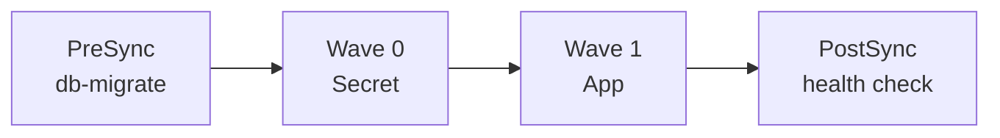

# Argo CD Sync Phases and Waves: DB Migration, Secrets, Health Check

```
my-app-manifests/
└── waves-demo/
    ├── db/                      # Application 1: the database
    │   └── db-service.yaml
    └── app/                     # Application 2: app + hooks
        ├── migrate-job.yaml     # PreSync
        ├── app-secret.yaml      # Sync, wave 0
        ├── service.yaml         # Sync, wave 1
        └── postsync-check.yaml  # PostSync
```

---------

## The Database set up

```yaml
#apiVersion: v1
#kind: Secret
#metadata:
#  name: postgres-credentials
#type: Opaque
#stringData:
#  POSTGRES_PASSWORD: demo-password
#
#---
#
apiVersion: apps/v1
kind: Deployment
metadata:
  name: postgres
spec:
  replicas: 1
  selector:
    matchLabels:
      app: postgres
  template:
    metadata:
      labels:
        app: postgres
    spec:
      containers:
        - name: postgres
          image: postgres:16-alpine
          env:
            - name: POSTGRES_DB
              value: appdb
            - name: POSTGRES_PASSWORD
              valueFrom:
                secretKeyRef:
                  name: postgres-credentials
                  key: POSTGRES_PASSWORD
          ports:
            - containerPort: 5432
          readinessProbe:
            exec:
              command: ["pg_isready", "-U", "postgres"]
            initialDelaySeconds: 5
            periodSeconds: 5
          # demo only: data is lost if the pod restarts (no volume)
---

apiVersion: v1
kind: Service
metadata:
  name: postgres
spec:
  selector:
    app: postgres
  ports:
    - port: 5432
      targetPort: 5432
```

## The DB Migration Job

`waves-demo/app/migrate-job.yaml`:

```yaml
apiVersion: batch/v1
kind: Job
metadata:
  name: db-migrate
  annotations:
    argocd.argoproj.io/hook: PreSync
    argocd.argoproj.io/hook-delete-policy: BeforeHookCreation
spec:
  backoffLimit: 2
  template:
    spec:
      restartPolicy: Never
      containers:
        - name: migrate
          image: postgres:16-alpine
          env:
            - name: PGHOST
              value: postgres
            - name: PGUSER
              value: postgres
            - name: PGDATABASE
              value: appdb
            - name: PGPASSWORD
              valueFrom:
                secretKeyRef:
                  name: postgres-credentials
                  key: POSTGRES_PASSWORD
          command: ["sh", "-c"]
          args:
            - |
              until pg_isready; do echo "waiting for db..."; sleep 2; done
              psql -v ON_ERROR_STOP=1 <<'SQL'
              CREATE TABLE IF NOT EXISTS schema_migrations (version INT PRIMARY KEY);
              CREATE TABLE IF NOT EXISTS items (id SERIAL PRIMARY KEY, name TEXT NOT NULL);
              INSERT INTO schema_migrations (version) VALUES (1) ON CONFLICT DO NOTHING;
              SQL
              echo "Migration done"
```


## Sync Phase, Secret (wave 0) then App (wave 1)

`waves-demo/app/app-secret.yaml`:

```yaml
apiVersion: v1
kind: Secret
metadata:
  name: app-secret
  annotations:
    argocd.argoproj.io/sync-wave: "0"
type: Opaque
stringData:
  API_KEY: demo-api-key-123
  DB_HOST: postgres
```

`waves-demo/app/service.yaml`:

```yaml
apiVersion: apps/v1
kind: Deployment
metadata:
  name: web
  annotations:
    argocd.argoproj.io/sync-wave: "1"
spec:
  replicas: 2
  selector:
    matchLabels:
      app: web
  template:
    metadata:
      labels:
        app: web
    spec:
      containers:
        - name: nginx
          image: nginx:1.27
          envFrom:
            - secretRef:
                name: app-secret
          ports:
            - containerPort: 80

---

apiVersion: v1
kind: Service
metadata:
  name: web
  annotations:
    argocd.argoproj.io/sync-wave: "1"
spec:
  selector:
    app: web
  ports:
    - port: 80
      targetPort: 80
```

Argo CD applies wave 0 and waits until it is healthy, then applies wave 1. 

## PostSync, the Health Check

`waves-demo/app/postsync-check.yaml`:

```yaml
apiVersion: batch/v1
kind: Job
metadata:
  name: web-healthcheck
  annotations:
    argocd.argoproj.io/hook: PostSync
    argocd.argoproj.io/hook-delete-policy: HookSucceeded
spec:
  backoffLimit: 1
  template:
    spec:
      restartPolicy: Never
      containers:
        - name: check
          image: postgres:16-alpine
          env:
            - name: PGHOST
              value: postgres
            - name: PGUSER
              value: postgres
            - name: PGDATABASE
              value: appdb
            - name: PGPASSWORD
              valueFrom:
                secretKeyRef:
                  name: postgres-credentials
                  key: POSTGRES_PASSWORD
          command: ["sh", "-c"]
          args:
            - |
              echo "Checking web..."
              wget -q -T 5 -O /dev/null http://web/ || { echo "WEB FAILED"; exit 1; }
              echo "Checking migration..."
              psql -tAc "SELECT version FROM schema_migrations WHERE version = 1" | grep -q 1 \
                || { echo "MIGRATION CHECK FAILED"; exit 1; }
              echo "ALL CHECKS PASSED"
```

It checks both that the app answers and that the migration was applied.

## Applications

`waves-apps.yaml`:

```yaml
apiVersion: argoproj.io/v1alpha1
kind: Application
metadata:
  name: waves-db
  namespace: argocd
spec:
  project: default
  source:
    repoURL: https://github.com/YOUR_ORG/my-app-manifests.git
    targetRevision: main
    path: waves-demo/db
  destination:
    server: https://kubernetes.default.svc
    namespace: waves-demo
  syncPolicy:
    automated:
      prune: true
      selfHeal: true
    syncOptions:
      - CreateNamespace=true
---
apiVersion: argoproj.io/v1alpha1
kind: Application
metadata:
  name: waves-app
  namespace: argocd
spec:
  project: default
  source:
    repoURL: https://github.com/YOUR_ORG/my-app-manifests.git
    targetRevision: main
    path: waves-demo/app
  destination:
    server: https://kubernetes.default.svc
    namespace: waves-demo
  syncPolicy:
    automated:
      prune: true
      selfHeal: true
    syncOptions:
      - CreateNamespace=true
```

```bash
kubectl apply -f waves-apps.yaml
```

> The migration Job waits for the DB with `pg_isready`, so it's fine if both Applications start at the same time.


```bash
kubectl get pods -n waves-demo -w
argocd app get waves-app
```

**Screen:** Title slide: "Argo CD Sync Phases and Waves"

"Deploying an app isn't just applying YAML. The database must be migrated, secrets must exist, and the app must be checked. Argo CD handles this order for you. Let's see how."

**[0:20 – 0:55] THE FLOW**
**Screen:** Mermaid diagram.



"Argo CD has three phases. **PreSync** runs first, here our database migration. Then **Sync**, where we use waves: wave zero creates the secret, wave one starts the app. Finally **PostSync** runs our health check."

**[0:55 – 1:45] THE CODE**
**Screen:** Show each file, highlighting annotations.

"The migration is a Kubernetes Job with one annotation: `hook: PreSync`. The SQL is idempotent, so it's safe to run on every sync.

The secret has `sync-wave: 0`. The Deployment has `sync-wave: 1`. Lower numbers go first, and Argo CD waits for each wave to be healthy.

One catch: PreSync runs before Sync, so the migration can't use a secret from the Sync phase. That's why our database and its credentials live in a separate Application."

**[1:45 – 2:30] THE DEMO**
**Screen:** Terminal with `kubectl get pods -w`, then the UI.

"We apply the Applications. Postgres starts. The migration Job runs and completes. Then the secret, then the web pods. Finally the health check passes: it verifies the app responds and the migration was applied.

Now I break the SQL and push. The migration fails, and Argo CD never touches the running app. A bad migration can't reach production."

**[2:30 – 2:50] OUTRO**

"PreSync for migrations, waves for order, PostSync for verification. All declared in Git. Like and subscribe, thanks for watching!"

---

## Production Tips

- **Pre-run the failure case** and have the log output ready.
- **Zoom on the UI's resource tree** to show the hook Jobs appearing in order.
- **Split the video** if it runs long: PreSync + PostSync first, waves as a second part.

Want a follow-up on **SyncFail hooks** to send a Slack alert when a migration fails?